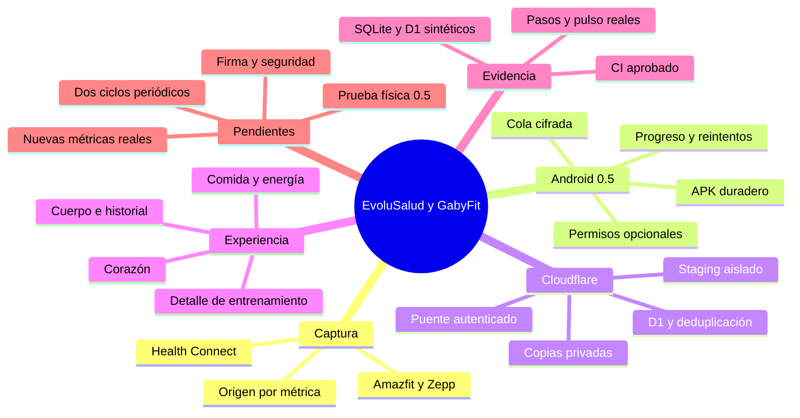

# MEMORIA MAESTRA — EVOLUSALUD + GABYFIT SYNC
**Corte documental:** 20 de octubre de 2026 · horario de Canarias.  
**Tipo:** memoria técnica para continuar el proyecto. Estado documentado; no monitorización en tiempo real.

## 1. Resultado y límite actual
EvoluSalud está publicada en Cloudflare Workers y utiliza D1. Existe recepción comprobada en producción de pasos, pulso y sesiones de sueño procedentes de Zepp. La usuaria confirmó la actualización de datos en Cuerpo tras finalizar el envío. El lector Android 0.5 y los servidores aceptan métricas adicionales; su llegada real depende de permisos y de que la aplicación de origen las escriba en Health Connect.

**La integración completa aún no está cerrada:** faltan instalación y validación física de la versión 0.5, comprobar cada origen adicional, su visualización autenticada y la repetición periódica sin duplicados. No confundir formularios, compilación o pruebas sintéticas con datos reales de todas las métricas.

Se guardó además un entrenamiento a partir de capturas facilitadas por la usuaria. Conserva fecha, procedencia manual y límites de transcripción. No se presenta como sincronización automática.

## 2. Arquitectura
Amazfit Active 2 (Round) → Zepp → Android Health Connect → GabyFit Sync → Worker de staging → D1 de staging → puente autenticado → Worker EvoluSalud → D1 de producción → dashboard.

- Android conserva su endpoint de staging fijo.
- El puente refleja en producción únicamente la fuente autorizada `com.huami.watch.hmwatchmanager`.
- Otras fuentes pueden diagnosticarse en el móvil; esto no equivale a tener producción preparada para múltiples usuarios o marcas.
- Los datos del propietario se guardan en D1. Los invitados mantienen su almacenamiento local.
- D1 sigue siendo la base elegida. No se ha migrado a Supabase.
- No hay envío de información personal a modelos de IA.

## 3. Direcciones y versiones
| Recurso | Dirección / referencia |
| --- | --- |
| Aplicación | https://evolusalud.gaby-franco.workers.dev/ |
| Staging | https://evolusalud-health-staging.gaby-franco.workers.dev/ |
| Repositorio | https://github.com/gabyfrancom/gabyfit |
| Rama | `feature/gabyfit-health-connect-sync` |
| PR de desarrollo | https://github.com/gabyfrancom/gabyfit/pull/1 |
| Estado PR al corte | Abierto, borrador y sin fusionar |
| Android actual | `0.5.0-staging`, versionCode 5 |
| Commit del APK | `7b543c1023331518614351376c9fccd0f571a157` |
| Compilación y pruebas | https://github.com/gabyfrancom/gabyfit/actions/runs/39490353975 |
| Release duradera | https://github.com/gabyfrancom/gabyfit/releases/tag/gabyfit-sync-staging-7b543c102333 |
| APK | https://github.com/gabyfrancom/gabyfit/releases/download/gabyfit-sync-staging-7b543c102333/GabyFitSync2-staging.apk |
| SHA-256 APK publicado | `2ab6f7ece0e2fc4a95c4a11b66cf663200ae7fd691a9ad3a049f414ed892ffc6` |
| Despliegue funcional anterior a esta memoria | `6cd917d7347f4117a7877e4cf10addb6` |

La Release incluye APK-SIGNATURE.txt, SOURCE-COMMIT.txt y SHA256SUMS.txt. Los assets de Release no tienen la caducidad automática de Actions; no se promete conservación eterna si se elimina el repositorio o la Release. Los artefactos temporales de Actions conservan su retención propia.

## 4. Trabajo realizado

### Infraestructura y backend
- Staging y producción están separados.
- Autenticación mediante Cloudflare Access y credenciales independientes de ingesta.
- Validación de registros, fechas, unidades, límites y origen.
- Confirmaciones de envío mediante `sync_id` y número de registros.
- Claves por propietario, origen, identificador y métrica para deduplicación.
- Tabla aditiva `wearable_sport_readings`, sin modificar datos clínicos.
- Vista `wearable_all_readings` unifica las tablas del reloj.
- Exportaciones y copia del reloj ampliadas para incluir las métricas deportivas.
- Historial diario con paginación; fechas mostradas en horario de Canarias.
- Se preservaron bindings, ASSETS y secretos en los despliegues.

### Android
- Se corrigió compileSdk a 36; JDK17 y Gradle8.11.1.
- Lectura de los últimos siete días, paginada.
- Permisos adicionales opcionales: su denegación no exige inventar datos.
- Credenciales y cola local cifradas con Android Keystore.
- HTTPS, sin redirecciones y sin secretos incluidos en el APK.
- WorkManager con conectividad y reintentos.
- Envío manual con progreso de registros confirmados y bloqueo de pulsaciones repetidas.
- Registro local de acuses: se omiten entradas sin cambios ya confirmadas; los cambios vuelven a enviarse. Acuse y retirada de cola son transaccionales.
- Estado de la tarea y fecha del último envío automático completado visibles en la aplicación.
- Sync 2 usa el paquete separado `com.gabyfit.sync.v2`: se instala al lado de la anterior y requiere importar el archivo privado y conceder permisos de nuevo.
- APK 0.5 compilado y publicado en Release duradera.

### Interfaz EvoluSalud
- Datos del reloj integrados en Cuerpo y contexto de nutrición y cardiovascular.
- Historial y selección de días anteriores.
- Se eliminó la necesidad de una pestaña Amazfit independiente.
- Etiqueta general “Importar datos de salud”; el cambio de etiqueta no garantiza compatibilidad con cualquier archivo de Health Connect.
- Autocompletado de valores disponibles sin inferir presión arterial, glucosa o perímetros.
- Calorías de reposo por diferencia únicamente con cobertura compatible de energía activa y total.
- Formulario “Detalle de carrera y entrenamiento”, con fecha y procedencia, en Cuerpo, Corazón y Comida.
- El entrenamiento transcrito conserva vueltas y zonas en notas. No se reconstruyeron curvas a partir de imágenes.
- No se suman automáticamente calorías de una sesión al gasto diario para evitar duplicarlas.

## 5. Contrato de métricas
| Grupo | Métricas | Estado al corte |
| --- | --- | --- |
| Recepción real comprobada | Pasos; frecuencia cardíaca; sesiones de sueño | En producción desde Zepp; datos actualizados en Cuerpo según confirmación de la usuaria |
| Básica aún por confirmar | Duración de entrenamiento | Lector y backend disponibles; sin evidencia real nueva de esta métrica en producción |
| Salud y energía opcionales | SpO₂; FC en reposo; distancia; energía activa; energía total; HRV RMSSD; respiración; VO₂máx; peso; grasa; temperatura | Preparadas; llegada real pendiente |
| Nuevas deportivas 0.5 | Velocidad; cadencia; potencia; ascenso | Android, almacenamiento e interfaz preparados; prueba física pendiente |
| Detalle manual | Ritmos; pulso medio/máximo; elevación; zancada; oscilación; contacto con suelo; carga y efectos de Zepp | Formulario y registro por sesión |
| No inferidos | Presión arterial; INR; glucosa; RPE ausente; VO₂máx medido a partir de zonas | No se fabrican ni autocompletan sin fuente |

**Unidades nuevas:** velocidad m/s (visualización km/h); cadencia pasos/min; potencia W; ascenso m.  
Las medias diarias de velocidad, cadencia y potencia son medias de las muestras recibidas, no medias ponderadas por tiempo ni necesariamente el resumen de un entrenamiento.

La duración de sueño representa el intervalo de sesión, no sueño efectivo. El ascenso acumulado no es altitud absoluta.

## 6. Herramientas de deporte y nutrición incorporadas
| Herramienta | Entradas / límites |
| --- | --- |
| Cunningham | Masa libre de grasa; estimación de metabolismo en reposo |
| Disponibilidad energética | Ingesta completa, gasto neto del ejercicio y masa libre de grasa; no diagnostica REDs |
| Carga session-RPE | Minutos × esfuerzo global 0–10; no equivale a carga Zepp |
| Sudoración estimada | Pesos antes/después, bebida, orina y duración |
| Recuperación de FC | FC al terminar y al minuto, con protocolo registrado |
| Ergoespirometría | Registro de VT1, VT2 y VO₂ pico de un informe profesional |
| REDs CAT2 | Registro de evaluación profesional; no diagnóstico automático |
| Perfil deportivo | Referencias de FC, reserva, actividad y capacidad; estimaciones identificadas |

Las puntuaciones del inicio y cardiovascular no son intercambiables. Un índice propio o una adaptación no se convierte en escala clínica validada por añadir fórmulas. No se aumentaron puntuaciones simplemente por declararse deportista.

Referencias de las herramientas:
- Cunningham: https://pubmed.ncbi.nlm.nih.gov/8537566/
- Disponibilidad energética: https://doi.org/10.1136/bjsports-2023-106994
- Session-RPE: https://pubmed.ncbi.nlm.nih.gov/11708692/
- Sudoración: https://pubmed.ncbi.nlm.nih.gov/17277604/
- REDs CAT2: https://pubmed.ncbi.nlm.nih.gov/37752002/

## 7. Pruebas y evidencia
| Verificación | Resultado / alcance |
| --- | --- |
| Compilación SDK36 y lint Android | Aprobados en Actions del commit indicado |
| Firma APK y registro de commit | Nueva identidad estable y huella comprobada antes de publicar; archivos de origen y firma incluidos |
| Sintaxis de la extensión JavaScript | Aprobada mediante Node en CI |
| Validación del contrato | Cuatro métricas nuevas, unidades y registros inválidos |
| Enrutamiento a tabla deportiva | Probado con base simulada |
| SQLite aislada | Migración, deduplicación, separación por propietario y restricción de métricas |
| D1 de staging | Dos escrituras sintéticas de una clave dejaron una fila; prueba retirada |
| Conservación clínica | Conteos existentes conservados durante los cambios; no se enviaron actualizaciones de analíticas o INR |
| Copia privada | Copia de documentos creada y releída; incluye el registro deportivo |
| Recuperación D1 | Disponibilidad de bookmark de Time Travel comprobada; no se ejecutó restauración sobre producción |
| Pantalla Cuerpo | La usuaria confirmó datos actualizados después del envío; no sustituye la revisión de todas las métricas ni la del nuevo APK |
| Teléfono 0.5 | Pendiente |

Una prueba de almacenamiento no demuestra por sí sola el recorrido completo Health Connect → móvil → API → D1 → pantalla.

## 8. Seguridad y continuidad
- No fusionar el PR sin autorización explícita.
- No borrar, sobrescribir ni migrar historiales médicos para realizar pruebas.
- Usar datos sintéticos en pruebas iniciales y staging.
- No guardar secretos ni información clínica en repositorios públicos o en esta memoria.
- No ampliar el puente a otras fuentes sin revisar identidad, aislamiento y permisos.
- Mantener HTTPS, validación, deduplicación y reintentos.
- Comprobar la rotación de credenciales mostradas en capturas anteriores; no consta una rotación verificada en este cierre.
- APK anteriores: firmas debug efímeras y conflicto de actualización observado. No se dispone de la clave antigua.
- Sync 2: firma estable obtenida mediante identidad OIDC de GitHub con restricciones de repositorio, propietario, rama, workflow, evento y vigencia. El material privado se conserva como secretos en un Worker dedicado, separado de los datos de salud; no se publica.
- No desinstalar la aplicación anterior: instalar Sync 2 al lado, detener la tarea antigua e importar la configuración en la nueva.
- Las copias locales Android están desactivadas.
- No activar IA con información personal sin consentimiento específico.

## 9. Pendientes ordenados
1. Detener la tarea diaria en la aplicación anterior e instalar Sync 2 (0.5) al lado. No requiere desinstalar ni borrar datos. Importar el archivo privado conservado.
2. Conceder permisos nuevos y acceso en segundo plano cuando esté disponible.
3. Diagnosticar fuentes por métrica: registrar DataOrigin, fecha y tipos realmente existentes.
4. Sincronizar manualmente con la configuración privada vigente.
5. Comprobar registros nuevos en D1 y visualización autenticada en Cuerpo, Corazón y Comida.
6. Repetir el envío y confirmar ausencia de duplicados.
7. Comprobar al menos dos ejecuciones periódicas; WorkManager no garantiza una hora exacta.
8. Para campos exclusivos de Zepp, conseguir una exportación legible o conservar entrada manual. No prometer API o exportación no verificadas.
9. Revisar borrados y cambios anteriores a siete días: todavía no están reconciliados.
10. Mantener la identidad estable de Sync 2 y revisar el procedimiento de recuperación privada y rotación de credenciales.
11. Completar revisión visual y una prueba de restauración en un entorno aislado.
12. Mantener cualquier función de IA pendiente del consentimiento específico.

## 10. Criterio de finalización
La integración estará finalizada cuando el APK esté probado en teléfono, el origen real esté confirmado, un registro autorizado recorra Health Connect → Cloudflare → D1 → dashboard, la repetición no genere duplicados, se comprueben las ejecuciones periódicas y se cierren las verificaciones de seguridad aplicables.

## 11. Archivos y código para continuar
- Aplicación original: `app/evolusalud.html`, `src/worker.js`, `src/shim.js`.
- Configuración original: build.mjs, package.json, schema.sql y wrangler.jsonc; variantes de pruebas separadas.
- Android: `android/GabyFitSync/`.
- Evidencia y snapshots de contrato/interfaz: `integration/wearables/`.
- Worker de producción: production-entry.js, original-worker.js, health-validation.js, health-storage.js, amazfit-ui.js.txt.
- Tablas del reloj: wearable_readings, wearable_extra_readings, wearable_sport_readings, wearable_sync_runs.
- Registro deportivo manual: colección docs; marcador `sports-clinical-v1`.
- Proyecto local referido por la usuaria: `C:\Users\gabyf\Documents\Claude\Projects\EvoluSalud`; su existencia y acceso no fueron verificados desde este entorno.

No asumir que el código local Windows, la rama de GitHub y los módulos desplegados coinciden en su totalidad. Leer la fuente actual antes de editar y sincronizar cambios de manera controlada.

## 12. Mapa mental

## 13. Instrucción de reanudación
Continuar desde esta memoria y verificar únicamente lo que pudo cambiar. No reinstalar herramientas, no reiniciar el proyecto y no presentar fases preparadas como integración completa. Revisar el commit del APK y el estado real de la rama antes de escribir. Pedir archivos únicamente si no son accesibles. Informar lo realizado con evidencia y los bloqueos concretos.

Esta memoria excluye credenciales, identificadores personales y valores médicos. El dashboard documental es una fotografía del estado del proyecto, no consulta la D1 clínica ni se actualiza solo.

## 14. Cierre de la incidencia de instalación y lentitud
- Conflicto de instalación observado al intentar sustituir el APK antiguo.
- Se preparó Sync 2 como instalación independiente para conservar la aplicación anterior.
- Firma estable en servidor de firma aislado; acceso OIDC de corta duración, sin claves privadas en GitHub ni en el APK.
- La cola nueva omite únicamente registros idénticos con acuse previo y reenvía cambios. El primer envío de una instalación nueva sigue revisando siete días.
- Auditoría de producción: sin claves duplicadas ni muestras iguales repetidas en los datos existentes al corte. No equivale a prometer deduplicación semántica universal.
- La sincronización automática sigue pendiente de comprobar en el teléfono y observar en dos ejecuciones reales.
